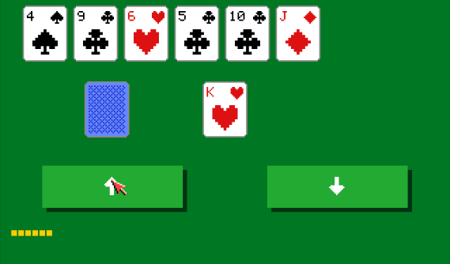
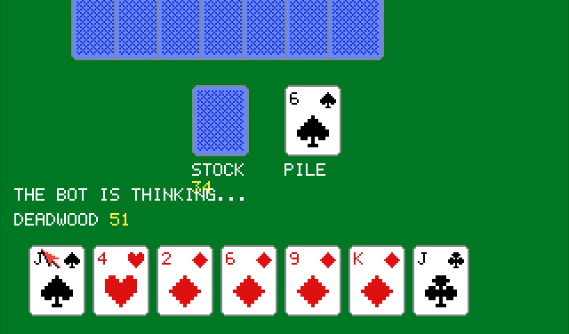
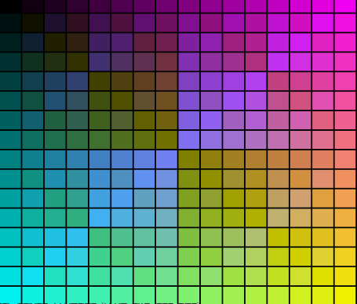
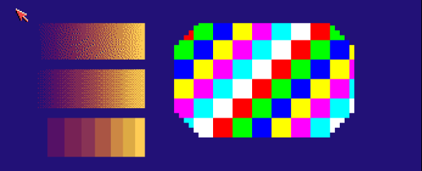
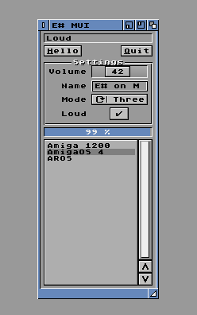

# E# (Amiga E#)

Write C#, get a native Amiga program: E# compiles a restricted, statically compiled subset of C# to C and builds it into
native code for the Amiga (68020+, AmigaOS 4 and MorphOS PowerPC, AROS) and a desktop build (SDL 3). The same `.cs` source also
runs under plain `dotnet`, so your game logic is unit tested and debugged on the PC before it ever touches an emulator.

[](https://github.com/GameGyrafe/amigaesharp/actions/workflows/ci.yml)
[](https://www.nuget.org/packages/AmigaESharp.Tool)
[](LICENSE)

<p>
  
  
  
  
  
</p>

<sub>All five are screens drawn by E# samples (the first four on an emulated A1200 in FS-UAE, the last on hosted AROS):
[cards](samples/cards), [rummy](samples/rummy), [aga](samples/aga), [assets](samples/assets), [mui](samples/mui).</sub>

```csharp
using ESharp;
using ESharp.Platform;

public static class Program
{
    [EntryPoint]
    public static void Main()
    {
        Dos.PutStr("Hello from E#!\n");
    }
}
```

**What it is, and is not.** Not .NET on the Amiga: there is no CLR, JIT, garbage collector or runtime IL, the output is plain native
code. Not a new language: normal `.cs` files, so Roslyn, IntelliSense and analyzers work unchanged, with extra meaning from
attributes (`[EntryPoint]`, `[AmigaLib]`, `[ChipRam]`, ...) and a small intrinsics library. Not all of C#: a defined subset is
accepted and the rest is rejected with clear diagnostics (`ES0001`...).

## Five-minute start

You need the [.NET 10 SDK](https://dotnet.microsoft.com/download). That is enough to write, run and test E# code on your PC:

```bash
dotnet tool install -g AmigaESharp.Tool      # the esharp command (from nuget.org)
esharp new mygame && cd mygame
dotnet run                                   # on the PC: Hello from E#!
esharp test                                  # the ok/FAIL checks, on the PC
esharp build --emit-only                     # writes obj/m68k/mygame.c; no C compiler needed
```

To build for an Amiga you also need **Docker** (the compilers live in pinned images), and to run the result the
**[FS-UAE](https://fs-uae.net) emulator** (plus `xvfb` for `--headless` on Linux):

```bash
esharp build --target m68k --docker amigadev/crosstools:m68k-amigaos@sha256:32ec76dac03a642203f0f09f0416480d6c25de1092ed7ed472db870304a64859
esharp run   --docker amigadev/crosstools:m68k-amigaos@sha256:32ec76dac03a642203f0f09f0416480d6c25de1092ed7ed472db870304a64859 --headless
```

`build` writes `obj/m68k/mygame` (an AmigaOS executable) and `mygame.info` (a Workbench icon); `run` prints the program's output.
Without `--kickstart <rom>` FS-UAE uses its built-in AROS ROM replacement, which runs most samples but is not the tested
target. **Bring your own Kickstart ROM**: none, and no Workbench disk or other copyrighted Amiga file, is in this repository or
the packages, and none will be. The test matrix is Kickstart 3.1 (40.069) on `--model A1200`; keep your ROM outside the repository.

The first block needs only .NET; the second needs Docker for the build and FS-UAE for the run. For the pieces in between (other
targets, SDL, hosted AROS, the OS4 VM, MUI, assets, icons, VS Code) see the [guide](docs/GUIDE.md).

## Features

Each links to a sample that shows it (every sample prints `ok` lines that `esharp test` compares between the PC and the target):

- **A large part of C# 12:** structs, enums, tuples, patterns, `ref` locals and returns ([language](samples/language),
  [operators](samples/operators), [properties](samples/properties), [patterns](samples/patterns), [refs](samples/refs)).
- **Classes, interfaces and generics:** heap classes with single inheritance, `virtual`/`override`, `is`/`as`, interfaces, generic
  structs and methods ([inherit](samples/inherit), [objects](samples/objects), [generics](samples/generics)).
- **Lambdas, closures, events and LINQ over arrays**, turned into loops ([lambdas](samples/lambdas), [closures](samples/closures),
  [linq](samples/linq)).
- **Collections and memory:** `Vec<T>`, `Pool<T>`, arenas, hash collections, chip RAM and a budget check
  ([collections](samples/collections), [memory](samples/memory)).
- **Graphics:** custom screens, blitter and masked blits, double buffering, AGA 256 colours and 24-bit palettes, RTG
  detection ([screen](samples/screen), [dbuffer](samples/dbuffer), [aga](samples/aga), [rtg](samples/rtg)).
- **Assets:** PNG and IFF ILBM images with dithering, WAV and 8SVX samples, converted by `esharp assets`
  ([assets](samples/assets), [cards](samples/cards)).
- **Games:** a card game and rummy against a bot, written from scratch ([cards](samples/cards), [rummy](samples/rummy)).
- **Input, sound and timing:** mouse, keyboard with keymaps, joystick, audio samples, frame timing
  ([keys](samples/keys), [controls](samples/controls), [sound](samples/sound), [timing](samples/timing)).
- **System GUI:** GadTools windows, BOOPSI objects and hooks, MUI windows whose notifications go to C# lambdas, MUI custom
  classes written in C#, file requester, fonts, IFF files ([gui](samples/gui), [guiclass](samples/guiclass), [boopsi](samples/boopsi),
  [mui](samples/mui), [muiclass](samples/muiclass), [asl](samples/asl), [fonts](samples/fonts), [iff](samples/iff)).
- **Low level when you need it:** `[InlineAsm]` (68020 and PowerPC with a C# fallback), `[Interrupt]` VBlank servers
  ([interrupts](samples/interrupts)), raw library bindings and tag lists ([hwinfo](samples/hwinfo)).
- **Debugging:** host builds step through under the .NET debugger; the Amiga build has a serial `Trace` and `esharp addr` to turn a
  crash address (m68k, AROS, AmigaOS 4) into a C# line ([trace](samples/trace), [crash](samples/crash), [DEBUGGING.md](docs/DEBUGGING.md)).
- **Workbench integration:** `.info` icons and program arguments from tool types ([wbstart](samples/wbstart),
  [mainargs](samples/mainargs)).
- **VS Code:** `esharp new` writes a project with tasks, a host debug launch and the subset analyzer showing errors as you type.

## How it works

Roslyn parses your C#; an analyzer checks that it stays inside the subset; the emitter writes C with `#line` directives that point
back at your source; a C compiler for the target (in a pinned Docker image) builds the executable. For tests the same source is built
by dotnet against managed fakes of the platform layer. Anything the emitter cannot translate is an error (`ES0099`), never a guess.

```
                         +--> E# analyzer (ES0001...) --> errors in the IDE and the build
  your .cs --> Roslyn ---+
                         +--> CEmitter --> C (#line) --> gcc per target: m68k | os4 | morphos | aros | aros-i386 | sdl
  same .cs + Target.Host fakes (HOST) --> dotnet --> run and unit test on the PC
```

More in [docs/ARCHITECTURE.md](docs/ARCHITECTURE.md): the projects, the pipeline, how one source builds for `AMIGA`, `SDL` and
`HOST`, where to add a feature, how host and target runs are compared.

## Targets

CPU and OS are separate axes. What is verified, as of [docs/STATUS.md](docs/STATUS.md) (where it says "not verified", so do we):

| `--target` | Platform | Builds | Runs in an emulator or VM | Real hardware |
|---|---|---|---|---|
| `m68k` (default) | AmigaOS 3.x, A1200 / Kickstart 3.1 | yes | yes, FS-UAE (Kickstart 3.1 on `--model A1200`) | not verified |
| `os4` | AmigaOS 4.1 PowerPC | yes | yes, in a QEMU pegasos2 VM you provide ([tools/os4vm](tools/os4vm/README.md)) | not verified |
| `morphos` | MorphOS PowerPC | the hello sample builds; some larger samples (gui, asl, cards) did not compile at the last check | not run | not verified |
| `aros` | AROS x86-64 | yes | yes, hosted AROS in a Docker image | not verified (not run on native PCs) |
| `aros-i386` | AROS i386 | yes | yes, hosted i386 AROS (the `mui` sample crashes there) | not verified (not run on native PCs or in a PC VM) |
| `sdl` | Linux x86-64 desktop through SDL 3 | yes | yes, headless and under Xvfb | macOS and Windows not verified |

The Amiga-only APIs (GadTools, BOOPSI, MUI, requesters, IFF, fonts, joystick) do not exist on `sdl` (error ES0102). FS-UAE cannot
run the PowerPC builds. Symbols for conditional code: `AMIGA` for every Amiga-family target, narrowed by `M68K`/`PPC`/`X86_64`/`I386`
and `AMIGAOS3`/`AMIGAOS4`/`MORPHOS`/`AROS`; `SDL`; and `HOST` for the dotnet test host.

## Status in brief

Early, and honest about it. Details and dates are in [docs/STATUS.md](docs/STATUS.md); the design and roadmap are in
[docs/PROJECT_CONTEXT.md](docs/PROJECT_CONTEXT.md).

- **Works and is tested:** the compiler, the platform layer and about forty samples, with unit tests that run the generated C with a
  host gcc, on Linux and on Windows in CI.
- **Verified in emulators and VMs:** classic 68k in FS-UAE (A1200, Kickstart 3.1), AmigaOS 4.1 in QEMU, hosted AROS (x86-64 and
  i386), and the `sdl` target.
- **Not verified:** any real Amiga hardware, MorphOS runs, AROS on native PCs, RTG on a real card, Windows beyond CI (no Docker or
  FS-UAE there), and the SDL target on macOS and Windows.
- **Known gaps:** the emitter reports `ES0099` for what it cannot do yet (a list is in STATUS.md, "Known limits of the emitter"); user
  classes may derive from platform classes only when those are marked `[Extensible]` (so far `GtWindow`); there is no garbage
  collector, so a stored closure is freed with `Heap.Free`; floating point is off by default; no exceptions, async or reflection; no
  source-level debugger for the Amiga build (host builds can be debugged under .NET).

**Minimum system: an Amiga 1200** (68020, AGA, 2 MB chip RAM, Kickstart/AmigaOS 3.1, installed on a hard disk). The A500, A600,
the 68000 and Kickstart 1.x/2.x are not supported.

## Get involved

Contributions and bug reports are welcome. Start with the issues labelled
[good first issue](https://github.com/GameGyrafe/amigaesharp/labels/good%20first%20issue), or any of the open
[issues](https://github.com/GameGyrafe/amigaesharp/issues). [CONTRIBUTING.md](CONTRIBUTING.md) has the details and the
[code of conduct](CODE_OF_CONDUCT.md) applies.

**Build and test from a checkout** (the .NET 10 SDK is enough for these):

```bash
dotnet test                                                          # unit tests, including generated C built and run with host gcc
dotnet run --project src/ESharp.Cli -- build samples/hello --emit-only
dotnet run --project src/ESharp.Cli -- test samples/language        # a sample on the host: ok/FAIL lines
```

The commands to run samples on an emulator, the VM and hosted AROS are in [AGENTS.md](AGENTS.md) and the [guide](docs/GUIDE.md).

**Rules every contribution follows:**
- **No Kickstart ROMs, Workbench disks or other AmigaOS files** in the repository, in issues or in pull requests; the same goes for
  the Amiga NDK and MUI (download them yourself and point the tools at your copy).
- **No GPL code.** Never copy code from Amiga E (its compiler is GPL), and avoid GPL/LGPL in anything linked into games.
- **Test the behaviour:** a new emitter feature needs a test that compiles the generated C and runs it, not only a check of the C text.
- **Keep [docs/STATUS.md](docs/STATUS.md) honest:** if you did not run it, write "not verified", and say what you ran it on.
- Emitter gaps are errors (`ES0099`), never guesses.

**Hardware reports wanted.** Nothing has run on a real Amiga yet. If you have an A1200 (original, accelerated or FPGA) or other
hardware, build the test pack (`tools/hwpack/build.sh`) and report in
[issue #100](https://github.com/GameGyrafe/amigaesharp/issues/100); real-hardware reports are the most valuable thing anyone can
add.

## Homage

The name and spirit come from **Wouter van Oortmerssen's Amiga E**, and from AMOS: a productive language for a retro machine with fast
edit-build-run cycles. E# is an unrelated project that shares only that ambition. It reuses no code from Amiga E (whose compiler
source is GPL); it is a design inspiration only.

## Related projects

- [CopperSharp68k](https://github.com/ilehtoranta/CopperSharp68k) (MIT) takes the other route to C# on the Amiga: an ahead-of-time
  compiler from compiled .NET IL straight to 68k code, with a managed runtime (garbage collector, exceptions) and a growing part of
  the .NET 10 class library. Choose it if you want ordinary .NET code on a 68k Amiga. E# instead compiles a checked subset of C#
  source to C (no runtime), aims at games, and targets the A1200 (68020/AGA), AmigaOS 4 and MorphOS (PowerPC), AROS and an SDL
  desktop build from the same source.

## Licence

MIT, copyright Gyrafe Software. See [LICENSE](LICENSE).
